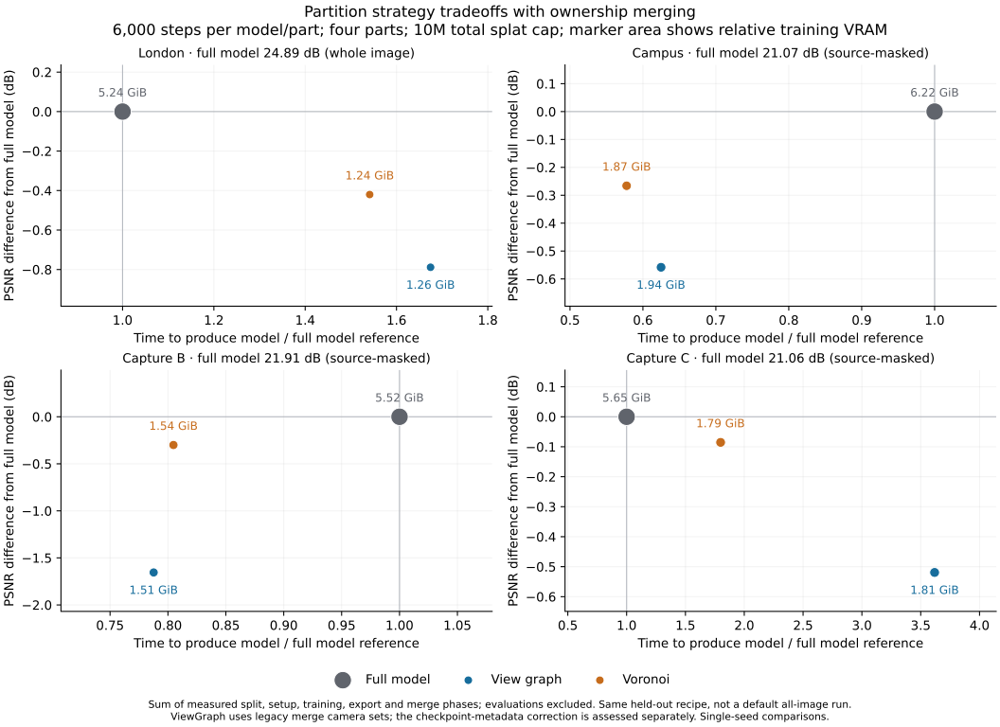
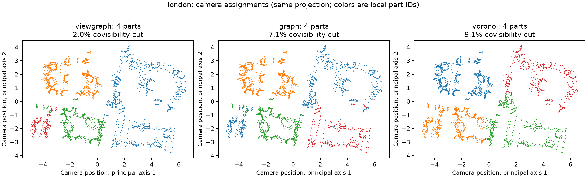
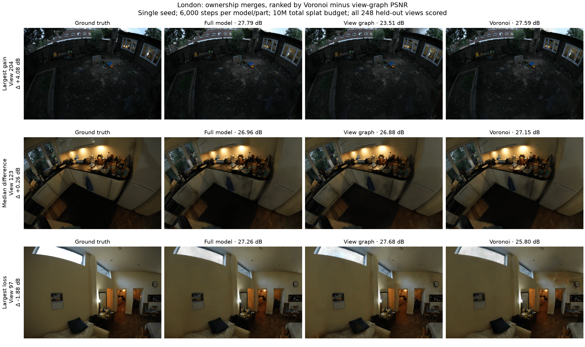

# Partition strategy and merge experiments

Measurement status: London primary, overlap, accelerated-update and original-code
controls are complete. Capture B full/ViewGraph/Voronoi results are complete.
Campus and capture C full/ViewGraph/Voronoi comparisons are complete, including
C's depth-filter control. London voxel/base controls and their output-path recovery are complete.
Larger-budget, exposure and London ownership-metadata controls are complete.
Density merging was removed after the completed quality/time/memory comparisons
failed to establish a useful advantage.
ViewGraph with ownership remains the default, with Voronoi available as an option.
Voronoi improves average quality over the primary ViewGraph rows on all four
captures, but local quality losses and scene-dependent total times support
keeping it selectable. The optional depth filter also remains off by default;
its capture C speed/quality benefit includes severe local failures.

The primary ViewGraph ownership rows use unmarked PLYs and all assigned part
cameras, including held-out poses, to orient directional ownership tests during
merging. Final marked checkpoints instead preserve the actual training cameras.
Those rows do not measure that new path. Euclidean Voronoi ownership
ignores the normal, so its result is unaffected by camera-set choice. A separate
London ViewGraph control preserves the trained PLY payloads and reports the
metadata effect below; its mean PSNR change is −0.0062 dB.



Production time sums the measured split, setup, training, export and merge
phases. Marker area is proportional to peak training VRAM relative to each
capture's full model; quality uses the common source-valid area where masks
are available. This is the primary single-seed matrix, with the ViewGraph
camera-set qualification above.

## Protocol

RTX 5070 12 GiB; Ryzen 7 7800X3D; 30 GiB system RAM. Native Vulkan builds,
four CPU cores per training command (including its built-in evaluation), sequential GPU jobs. Separate zero-step quality evaluations and visual diagnostics use eight physical cores after a validated resource-only update; completed four-core evaluations are retained with explicit provenance. CPU split surveys used
four parts, 200,000 ownership seeds, 200,000 projected samples, and ring 0.1.
Real tracks take precedence on London, campus and capture B. Capture C has
no tracks and uses sampled projection. Private capture names and source paths
are retained only in local benchmark artifacts.

Native training, merging and zero-step evaluation normally run with a 12 GiB
cgroup `MemoryMax` and no swap. Author base/detail and larger-detail controls
use 21 GiB; CPU split surveys use 10 GiB. Separately labeled capacity tests have
their own limits. These caps account for filesystem cache as well as anonymous
memory, so they can affect I/O and timing even when process RSS is well below
the limit. The machine's 30 GiB total RAM does not imply unrestricted caching.

An initial archive copy was stopped by `systemd-oomd` after filesystem cache
pressured its 4 GiB supervisor scope. No native benchmark was running and
source data remained intact. The retry used a separate 12 GiB archive scope,
verified checksums and flushed the destination before removing the source;
benchmark results were preserved. This was a scoped pressure kill, not an
observed system-wide RAM exhaustion.

| Capture | Cameras | Sparse points | ViewGraph seconds / GiB RSS | Joint graph seconds / GiB RSS | Voronoi seconds / GiB RSS |
|---|---:|---:|---:|---:|---:|
| London | 1,984 | 561,501 | 2.38 / 1.01 | 2.96 / 1.01 | 1.52 / 1.01 |
| Campus | 22,042 | 4,726,131 | 29.38 / 1.47 | 16.11 / 1.47 | 6.59 / 1.47 |
| Capture B | 5,314 | 3,089,199 | 8.29 / 0.77 | 3.60 / 0.77 | 1.74 / 0.77 |
| Capture C | 7,430 | 3,240,026 | 142.04 / 6.94 | hit 10 GiB cap at 50 s | 67.51 / 6.94 |

All completed splits produced four parts. Campus previously returned one part
for a request of four because tiny disconnected components consumed its cuts;
the component-count fix is separate from the choice of strategy. Voronoi
boundaries are convex camera-centroid cells. The capture C timing uses robust
fitting: a supplied pose thousands of times farther from its neighbors than
the median no longer consumes a singleton part. Every camera remains assigned,
including that outlier. The other three captures had no fitting outliers.



All 1,984 London camera centers share one principal-axis projection; colors are
local part IDs. This shows core camera assignments, not overlap rings or the
three-dimensional ownership surfaces. Voronoi gives compact spatial groups,
while ViewGraph cuts fewer covisibility edges in this capture. Compactness
alone does not establish reconstruction quality. The dataset attribution below
also applies to this plot.

Projection frustum membership does not establish visibility through walls.
Capture C generated 21.69 million camera pairs, explaining its dense graph and
mixed camera assignments. A coarse optional depth filter with 10% slack gives:

| Capture C control | Split seconds | Peak RSS GiB | Core cameras | Ring cameras |
|---|---:|---:|---|---|
| ViewGraph + depth | 59.32 | 2.35 | 2321, 1936, 1735, 1438 | 3020, 2895, 2974, 2379 |
| Joint graph + depth | 70.10 | 4.59 | 2343, 2195, 2009, 883 | 3294, 2936, 2895, 1515 |
| Voronoi + depth | 42.88 | 2.48 | 2913, 1885, 1516, 1116 | 2683, 2959, 2643, 2257 |
| ViewGraph + proximity | 1.31 | 0.23 | 3729, 3212, 337, 152 | 17, 4, 17, 0 |

Covisibility-cut percentages in the plots use each variant's own graph;
69% versus 42% is not a common-graph quality comparison.
Depth filtering reduced the pair count to 19.28 million and made assignments
more spatially coherent; this is a preprocessing measurement, not evidence
that thin structures survive training. Proximity avoids visibility work but
produces uneven cores and almost no overlap. Lowering projection sampling to
20,000 did not resolve this capture: ViewGraph timed out at 300 s after graph
construction and joint graph hit its 10 GiB cgroup cap after 17 s. No system
OOM occurred. A contaminated run with a low MemoryHigh limit was excluded.

## Training and quality protocol

The main comparisons use 6,000 iterations for the full model and for each of
four parts, an equal total splat cap, maximum image dimension 1,200, SH3, and
every eighth image held out from supervision before partition filtering.
The GUI queue applies its selected cap and iteration count to each part. This
benchmark explicitly assigns 2.5M splats to each of four parts for a 10M total;
leaving a 10M cap on every part would request a 40M aggregate model and a
different amount of work. Both
full and partitioned models use the supplied full SfM geometry and camera poses;
geometry is not withheld. Progressive image resolution is disabled throughout
these partition comparisons. The saved progressive-splat-budget flag is true,
but its image-stage schedule is gated by progressive resolution; ordinary
refinement and densification still grow the model toward its cap. These runs
are separate from the progressive-resolution forecasting experiments.
Partition fitting and merge orientation can therefore
use held-out poses, but no held-out images are sampled by the training loop. Sampling uses fixed
seed 42; these are single-seed comparisons, not statistical significance tests. Thus four parts have
four times the optimizer updates; this must not be mistaken for an equal-time or equal-image-exposure comparison. The default batch policy rounds training-camera count divided by 800, so a full run and its parts can have different batch sizes. Resolved batch sizes and nominal source-image exposures accompany each aggregate. Smaller epoch/resolution-group remainders are not logged, so nominal counts are upper counts rather than exact traced exposures.
For large camera subsets, this batch policy makes 6,000 steps roughly 7.5
nominal passes per training view: campus full uses 144,000/19,286 = 7.47,
and ViewGraph part 0 uses 78,000/10,151 = 7.68. Four times the optimizer
updates therefore need not mean four times the training per view. Overlap
duplicates still add aggregate exposures, while rounding and the minimum batch
size of one change this relationship for smaller subsets such as London.

A separate London control uses four times 1,500 iterations and proportionally
accelerated densification and appearance warmups, preserving disabled values.
The saved baseline uses SH warmup zero, retained in every run. OS page caches
were not flushed between the sequential full/ViewGraph/Voronoi runs, despite
disabling persistent downscaled-image caching. Run ordering and cache state can
affect these single-run timings; the modest London strategy timing difference
is an observation, not a statistically established speedup.

Full and merged PLYs are evaluated through the same zero-step reload path.
Raw whole-image and source-masked PSNR/SSIM are retained separately. When all
compared models have source-masked metrics, conclusions about reconstruction
quality use that common valid area; raw metrics remain visible. Capture B's
source masks identify the lens-validity footprint, excluding image corners
that training does not supervise. These fixed source masks are distinct from
per-part ownership masks. Final unpartitioned PLY evaluation reads the same
source masks for the full model and every merged model. A low whole-image score
outside the trained footprint alone is not evidence that a partition strategy
failed. Campus staging includes all 22,042 supplied binary masks alongside
its images; white pixels are included and black pixels excluded. These masks
are not assumed to have capture B's lens-footprint semantics. Their relative
names match every source image, and sampled dimensions agree. Campus training
had not begun when this staging omission was corrected; geometry-only CPU
partition surveys are unaffected.
Report training-only time, training plus merge time, wall time including
initialization/evaluation, held-out PSNR/SSIM, actual retained splat count,
peak sampled process VRAM and peak host RSS. Training cap alone is not the
retained merged count. Default automatic initialization targets 10% of each
run’s cap while retaining a larger supplied sparse seed set; initial populations
therefore change with capacity and overlap seed policy, and are recorded in traces. London comparison renders support visual seam review.
An original-binary ViewGraph control uses exactly the corrected branch's split
to separate indexing/ownership fixes from strategy effects.

The experimental density rule selected the most populated input per voxel; it is only one
part of splat-merge's workflow. The initial voxel size 0.5 and max-scale
threshold 0.01 match the pinned reference's defaults; both depend on dataset
units. These inputs were trained with Spirula's
regional masks and outside-region weighting; the result does not establish
how the same merge behaves on independently trained, unconstrained captures.
A separate local harness calls that project's
unmodified Rust scale-selection code with the full model as the large-scale
base and the density merge as fine detail. Its global training cost must be
included, and any output count above the main cap must be explicit. London
base/detail training cost is the sum of all four detail training times plus
503.375 seconds for the full base, even when the saved baseline is reused. Its
merge cost includes both the density selection and the scale/base pass. Reusing
a model avoids rerunning work in the experiment; it does not make that work free
for a user starting from the dataset. The recipe's peak training VRAM is the
maximum across the full base and every detail run. The reused 10M base already
requires 5.245 GiB, so this workflow cannot claim an overall training-VRAM
reduction against that same full baseline; detail-only VRAM is a separate
component measurement. CPU merge and final PLY-evaluation peaks are reported
separately.

London voxel/base controls read and write through the archived HDD directories.
Their merge wall times are not directly comparable to the primary NVMe merges.
Any reused density-phase time retains its original measurement provenance; a
combined cost is a sum of those measured phases, not one uninterrupted storage
configuration. Control logs record resolved input/output locations, including
any mixed placement in the later larger-detail experiment.

## London, equal aggregate cap

All rows use a 10M aggregate cap. The four part models each have a 2.5M cap;
actual exports and crops explain the smaller final counts. Peak training VRAM
is the maximum sampled process allocation across each method's runs, not the
zero-step evaluation allocation. Peak run RSS is measured over the entire native
command, including initialization and its built-in evaluation; it is not an
isolated training-loop memory measurement.

| Model | Training s | Merge s | Train + merge s | Artifact s | Workflow s | PSNR | SSIM | Retained M | Peak training VRAM GiB | Peak run RSS GiB |
| --- | ---: | ---: | ---: | ---: | ---: | ---: | ---: | ---: | ---: | ---: |
| Full | 503.38 | — | 503.38 | 510.99 | 560.70 | 24.8896 | .849893 | 10.0000 | 5.245 | 2.534 |
| ViewGraph, ownership | 803.84 | 17.46 | 821.29 | 855.70 | 926.30 | 24.1009 | .836496 | 9.8140 | 1.260 | 1.595 |
| ViewGraph, density 0.5 | 803.84 | 5.91 | 809.74 | 844.15 | 914.75 | 22.6689 | .804883 | 9.6542 | 1.260 | 1.595 |
| Voronoi, ownership | 745.81 | 4.59 | 750.40 | 787.58 | 868.56 | 24.4694 | .843002 | 9.8060 | 1.239 | 1.546 |
| Voronoi, density 0.5 | 745.81 | 5.00 | 750.81 | 787.99 | 868.97 | 22.7068 | .818075 | 9.6223 | 1.239 | 1.546 |

Artifact production sums the measured time from each native command's start
through its flushed post-checkpoint completion event, plus splitting and merging.
It includes preparation, training and export, and excludes built-in evaluation
and process teardown. This is a phase sum for the same held-out training views
and batches, not a separately measured default/all-image run. The stock
`eval_mode=all` trains on every image, changing both the training set and possibly
the batch size; removing evaluation time alone does not reproduce that recipe.

Evaluated workflow includes the entire native commands, their built-in held-out
evaluations, splitting and merging; final merged-model evaluation is excluded.
Repeating merged PLY evaluation is a measurement expense, not required to
produce the final model. Training plus merge excludes initialization and export.

Voronoi ownership improves 168 of 248 held-out views over ViewGraph, averaging
+0.3685 dB PSNR, while reducing training by 7.2%. It still trails the full model
by 0.4202 dB and costs 1.49 times as much training plus merge time. Its peak
training VRAM is 24% of the full run. This establishes a memory tradeoff, not
a total-time win. The matched-update control is reported separately.

Visual inspection is mixed: a television/fireplace floater is substantially
reduced in view 16, but view 97 has stronger wall ghosting (25.80 dB versus
27.68 dB ViewGraph and 27.26 dB full). Density-only view 4 has severe foreground
ghost surfaces in the garden. These are selected failure cases, not average
views. Ownership masks suppress detail outside each part; replacing ownership
with a voxel winner on these particular inputs is not the author's full recipe.
An overlap-trained control removes regional suppression and retains all observed
outside seeds while keeping camera membership and ownership fields identical.



Rows select views 204, 123 and 97 by Voronoi-minus-ViewGraph PSNR: largest
gain, median difference and largest loss. They expose both benefits and
failures; they are not random representative samples. Ground truth is from
[Zip-NeRF London](https://jonbarron.info/zipnerf/), released through
[SMERF](https://smerf-3d.github.io/) under
[CC BY 4.0](https://creativecommons.org/licenses/by/4.0/).
See [image attribution and modifications](assets/partition-benchmarks/ATTRIBUTION.md).

## Capture B, equal aggregate cap

The fixed source masks cover the lens-validity footprint. Both raw and masked
metrics are shown; the masked comparison measures the common supervised area.

| Model | Training s | Train + merge s | Artifact s | Workflow s | Raw PSNR / SSIM | Masked PSNR / SSIM | Retained M | Peak training VRAM GiB | Peak run RSS GiB |
| --- | ---: | ---: | ---: | ---: | --- | --- | ---: | ---: | ---: |
| Full | 2642.00 | 2642.00 | 2652.92 | 2958.87 | 16.9920 / 0.621711 | 21.9115 / 0.683282 | 10.0000 | 5.521 | 4.307 |
| ViewGraph, ownership | 1746.97 | 1764.48 | 2089.44 | 2465.76 | 16.5197 / 0.604938 | 20.2565 / 0.663572 | 9.8495 | 1.513 | 3.014 |
| ViewGraph, density 0.5 | 1746.97 | 1752.85 | 2077.82 | 2454.14 | 12.7880 / 0.510708 | 16.2503 / 0.608877 | 9.8987 | 1.513 | 3.014 |
| Voronoi, ownership | 1793.76 | 1801.54 | 2134.92 | 2530.18 | 17.1623 / 0.623290 | 21.6115 / 0.679722 | 9.8373 | 1.537 | 2.972 |
| Voronoi, density 0.5 | 1793.76 | 1802.05 | 2135.43 | 2530.69 | 12.9234 / 0.521922 | 16.7938 / 0.623125 | 9.8840 | 1.537 | 2.972 |

ViewGraph ownership reduces observed training time by 34% and workflow time by
17%, but loses 1.6550 dB in the source-valid area. Voronoi ownership loses only
0.3000 dB against full, with 32% less training time, 14% less workflow time and
28% of full peak training VRAM. Its raw score is slightly higher than full;
the common source-valid comparison still favors full. These are measured
time/memory versus quality tradeoffs, not unconditional improvements.

The full run resolves batch size 6 (36,000 nominal source images), ViewGraph
parts 2/2/2/1 (42,000), and Voronoi parts 3/2/2/1 (48,000). Voronoi training is
2.7% slower than ViewGraph and uses more nominal image exposures, so their
quality difference is not an isolated boundary-shape experiment. ROI-mask
setup accounts for 312.65 seconds for ViewGraph and 325.11 for Voronoi.

Voronoi improves masked PSNR over ViewGraph in 493 of 665 views: mean +1.3550 dB,
median +0.3449 dB, tenth percentile -0.2565 and ninetieth percentile +5.4346.
The largest gain is +12.2042 dB at view 310; the largest loss is -1.2408 dB at
view 409. The mean includes strong gains in ViewGraph's worst-loss cluster.

The local private visual panel uses views 310 (largest gain), 640 (near the
full-set median), and 510 (worst among the 67 saved views, not full-set worst
409). Voronoi removes most of ViewGraph's large dark sky artifacts at 310 while
static geometry broadly aligns. At 640, differences are subtle and all models
lose fine grass/net detail; at 510, all blur or ghost the narrow alley, with
Voronoi slightly worse. These RGB views do not establish a boundary-seam cause
or distinguish foreground splats from coverage or opacity gaps. The panel is
kept local because the capture is private. Density-only merging is substantially
weaker on these region-suppressed inputs; the author-inspired training and
base/detail controls are needed before a broader conclusion.

## Campus, equal aggregate cap

| Model | Training s | Train + merge s | Artifact s | Workflow s | Raw PSNR / SSIM | Masked PSNR / SSIM | Retained M | Peak training VRAM GiB | Peak run RSS GiB |
|---|---:|---:|---:|---:|---|---|---:|---:|---:|
| Full | 6106.33 | 6106.33 | 6126.05 | 7098.40 | 20.5294 / .718714 | 21.0680 / .725212 | 10.0000 | 6.225 | 3.591 |
| ViewGraph, ownership | 3349.15 | 3366.89 | 3827.27 | 4985.46 | 20.0289 / .708756 | 20.5098 / .715137 | 9.6968 | 1.941 | 2.205 |
| ViewGraph, density 0.5 | 3349.15 | 3355.67 | 3816.06 | 4974.25 | 16.2853 / .649846 | 16.5420 / .655598 | 9.7951 | 1.941 | 2.205 |
| Voronoi, ownership | 3072.96 | 3075.69 | 3538.71 | 4727.96 | 20.2970 / .712849 | 20.8021 / .719265 | 9.8066 | 1.868 | 2.091 |
| Voronoi, density 0.5 | 3072.96 | 3078.48 | 3541.50 | 4730.75 | 15.9307 / .647070 | 16.1660 / .652785 | 9.8479 | 1.868 | 2.091 |

ViewGraph ownership reduces observed artifact-production time by 37.5% and
peak training VRAM to 31.2% of full, while losing 0.5582 dB source-masked PSNR
and .010075 SSIM. It improves 686/2,756 views over full, with median −0.4539 dB,
a worst loss of −5.2028 dB and a best gain of +3.0860 dB. Its source-masked
color-corrected PSNR/SSIM is 24.5683/.729141. The four batches are 13/8/5/3,
giving 174,000 nominal exposures over 23,252 camera assignments. ROI-mask
preparation totals 437.24 seconds and is included in artifact/workflow times.
Density-only merging loses another 3.9678 dB against ownership in the valid
area, despite retaining more splats.

Voronoi ownership gains 0.2923 dB over ViewGraph and trails full by 0.2659 dB
in the source-valid area. Artifact production is 7.54% shorter than ViewGraph
and 42.24% shorter than full; peak training VRAM is 30.0% of full. Its batches
11/9/5/4 also give 174,000 nominal exposures, although camera assignments differ.
ROI setup totals 445.36 seconds. It retains 1.13% more splats than ViewGraph.
Masked color-corrected PSNR/SSIM is 24.9426/.733081.

Voronoi improves 1,744/2,756 views over ViewGraph, with median +.2336 dB and
range −3.8796 to +5.3795 dB. The best improvement is view 234, previously the
worst ViewGraph loss against full. Its worst view 2490 also loses 6.1402 dB
against full. Voronoi beats full on 945 views, with median −.2290 dB overall;
the aggregate benefit over ViewGraph is not uniform. Voronoi density loses
4.6361 dB against Voronoi ownership despite a similar retained count.

The full run uses 19,286 training cameras at batch size 24, or 144,000
nominal source-image exposures. All final models are scored on the same
2,756 held-out views. Full source-masked color-corrected PSNR/SSIM is
25.3330/.738590.

The separate PLY reload took 635.51 seconds and 4.710 GiB peak RSS. Its reported
aggregate metrics match the native evaluation; maximum per-view differences
are 0.0001 dB raw PSNR and 0.0003 dB masked color-corrected PSNR. The 28-view
interval-800 visual subset exactly matches the selected PLY-evaluation rows.
The matching ViewGraph ownership subset took 15.86 seconds and also exactly
matches its primary rows across all eight quality metrics. Its sampled
worst/median/best masked deltas against full are −4.1785/−.5919/+1.1054 dB
(global views 300/1800/2700); the full-set worst is view 234. These additional
evaluations are excluded from workflow time.

The visual diagnostic checks the largest sampled color-correction gap, a
near-median gap, and the lowest/highest sampled raw PSNR. Buildings, roads,
railings and cars align, and the supplied mask excludes a black rig region.
One view renders brighter than its photograph; another has darker, blurrier
vegetation. There is no gross pose, calibration or mask mismatch in those
views. Photometric differences plausibly contribute to the correction gap,
but are not established as its sole cause. Fine vegetation and pavement blur
remain: this is a 6,000-step, 10M-cap result, not convergence evidence.

The matched ViewGraph panel shows stronger window-frame warping/ghosting and
uneven pavement color in sampled worst view 300. Its 4.18 dB masked loss
remains 2.89 dB after color correction, so global brightness alone does not
explain it. Median view 1800 has subtle mixed differences (PSNR −.59 dB,
SSIM +.0056); best view 2700 includes sky brightness closer to the photograph
(raw gain 1.11 dB, corrected gain .53 dB), while both models blur fine detail.
RGB comparisons alone do not establish a partition-seam cause. The panel stays
local. On those matched frames, Voronoi reduces the window/pavement artifacts
at 300, has subtle mixed differences at 1800, and loses the closer sky tone
ViewGraph achieved at 2700. A separate 28-view-pool selection shows better
hillside/wall appearance at 2100, poorly resolved vegetation in every model
at 1300, and the same relative loss at 2700.

Sparse interval evaluations captured exact full-set extremes 234 and 2490
without rendering the full set again. All eight metric arrays equal the
corresponding primary slices, and 18 repeated-anchor PNG hashes match the
ordinary subsets. These six diagnostic jobs took 55.73 seconds, excluded from
workflow comparisons. At 234, Voronoi largely removes ViewGraph ghosting/haze
around a balcony pillar and trees: masked PSNR is 25.7044 versus 20.3249
(ViewGraph) and 25.5277 (full), although full SSIM remains higher. At 2490,
Voronoi has large colored/dark sky patches above the roof, ViewGraph is milder,
and full is cleaner. The deficit against full remains 6.10 dB after color
correction. These are observed rendering failures, not an established seam
mechanism, and argue for an alternative rather than a universal strategy win.

## Capture C, equal aggregate cap

| Model | Training s | Train + merge s | Artifact s | Workflow s | Raw PSNR / SSIM | Masked PSNR / SSIM | Retained M | Peak training VRAM GiB | Peak run RSS GiB |
|---|---:|---:|---:|---:|---|---|---:|---:|---:|
| Full | 2454.20 | 2454.20 | 2462.32 | 2875.82 | 17.7572 / 0.755277 | 21.0645 / 0.813797 | 10.0000 | 5.652 | 2.718 |
| ViewGraph, ownership | 6946.70 | 7403.24 | 8908.87 | 10406.69 | 17.5131 / 0.737227 | 20.5452 / 0.794156 | 7.7849 | 1.805 | 2.448 |
| ViewGraph, density 0.5 | 6946.70 | 6952.50 | 8458.13 | 9955.95 | 16.6757 / 0.720455 | 19.0898 / 0.771665 | 8.6971 | 1.805 | 2.448 |
| Voronoi, ownership | 3100.55 | 3103.68 | 4428.17 | 5808.71 | 17.7464 / 0.749854 | 20.9791 / 0.807652 | 9.0374 | 1.789 | 2.396 |
| Voronoi, density 0.5 | 3100.55 | 3106.55 | 4431.04 | 5811.58 | 16.1924 / 0.709853 | 18.2703 / 0.759386 | 9.2914 | 1.789 | 2.396 |
| ViewGraph + depth, ownership | 3142.41 | 3215.39 | 4216.26 | 5257.88 | 17.6993 / 0.747714 | 20.8842 / 0.805362 | 8.9214 | 1.718 | 2.312 |
| ViewGraph + depth, density 0.5 | 3142.41 | 3147.78 | 4148.65 | 5190.27 | 16.0203 / 0.698178 | 17.9900 / 0.744747 | 9.3281 | 1.718 | 2.312 |

Voronoi ownership improves source-masked PSNR by 0.4339 dB over ViewGraph,
with 750/929 views improved and median +0.3697 dB. Artifact production is
50.3% shorter than ViewGraph, but remains 79.8% longer than full. Its peak
training VRAM is 31.7% of full. It trails full by only 0.0854 dB on average,
with lower SSIM (.807652 versus .813797); 408/929 views beat full and the median
difference is −0.0651 dB. The per-view range against ViewGraph is −1.4479 dB
at view 718 to +4.1381 dB at view 256. These results support a memory/quality
tradeoff, not a total-time improvement over unpartitioned training.

Projected overlap assigns almost the whole capture to some parts. ViewGraph
part 1 contains all 6,501 training cameras. Full uses batch 8 and 48,000 nominal
source-image exposures; ViewGraph uses 8/8/7/7 and 180,000, while Voronoi uses
7/7/7/6 and 162,000. ROI-mask setup takes 1,341.20 seconds for ViewGraph and
1,246.78 for Voronoi. Ownership merging adds 456.54 seconds for ViewGraph versus
3.12 for Voronoi. All these phases are charged in the table. Exposure counts
alone do not establish the cause of the remaining training-time difference.
The final retained models also differ: 7.785M ViewGraph versus 9.037M Voronoi.

The 10%-slack projected-depth ViewGraph control improves masked PSNR by
0.3390 dB over unfiltered ViewGraph and reduces artifact production by 52.7%.
Its 6/5/5/4 batches total 120,000 nominal exposures; ROI setup takes 934.13 seconds
and ownership merging 72.98. Measured splitting takes 57.20 seconds and 2.228 GiB
RSS, versus 154.40 seconds and 6.940 GiB in the main ViewGraph run. These native
training splits are separate measurements from the CPU survey above.

Depth filtering improves 714/929 views over unfiltered ViewGraph, with median
+0.2990 dB. It still trails full by 0.1803 dB on average and costs 71.2% more
artifact-production time. Its worst deficit against full is 5.2811 dB at view
495, so average improvement does not establish that the coarse visibility proxy
preserves every structure. The default remains disabled.

Capture C uses supplied exclusion masks; their meaning is not assumed to match
capture B's lens-validity footprint. The existing XML parser approximates sensor
skew onto the fisheye/thin-prism camera model, reporting a maximum error of
0.233 pixels. Every comparison uses the same loader and calibration settings.
Density-only merging loses 1.4554, 2.7088 and 2.8942 dB against the respective
ViewGraph, Voronoi and depth-filtered ownership results despite retaining more
splats. Its retained count does not establish model quality.

The 93 saved interval-80 views exactly match primary evaluation rows
0, 10, 20, … across all eight metric arrays. Balanced local
panels select the largest sampled gain, a view near the full-set median, and
the largest sampled loss. Voronoi reduces ViewGraph wall/ceiling ghosting at
view 730 (+2.534 dB), while foreground figures remain blurred in every model.
View 170 has subtle mixed stairwell differences. At 550, Voronoi loses 0.8308 dB
raw source-masked PSNR but improves SSIM and color-corrected PSNR, consistent
with a color/exposure difference rather than demonstrated structural loss.

The depth-filter panel reduces table/room ghosting at view 30. Its sampled
median view 900 gains 0.299 dB but loses SSIM (.770290 versus .787049), so the
metrics disagree on that example. View 190 is the exact largest depth-filter
loss against unfiltered ViewGraph across all 929 views: door/portal geometry
has strong smearing and ghosts, with a 3.3634 dB PSNR loss and .056389 SSIM loss.
A 1.8684 dB color-corrected deficit remains. RGB evidence does not establish
whether an ownership seam or the visibility approximation caused that failure.
The fisheye scene geometry aligns with the photographs; all comparisons use
the same masks. Private comparison images remain local.

## Original-code control

The original executable trained the same saved ViewGraph partition with the
same seed, settings and caps. Its ownership merge scored 24.1309/.837334,
compared with 24.1009/.836496 for corrected ViewGraph. This single run does not
demonstrate a quality gain from the correctness fixes; the ownership/indexing
regressions establish the intended semantics. Strategy comparisons use corrected
ViewGraph, keeping the original-code result separate.

Original training took 778.53 seconds and its merge 14.13 seconds (792.66 seconds
combined), retaining 9.8041M splats. Its artifact-production phase sum is
824.19 seconds, excluding the reused split and built-in evaluations. Its merge
used 4,196,456 KiB peak RSS,
versus 128,060 KiB for the streaming ViewGraph primary (about 4.00 GiB versus
125 MiB). The streaming run took 17.45 seconds. These are separately trained
same-capacity inputs, and nearest-camera querying also changed, so the entire
3.3-second difference cannot be attributed solely to the extra streaming pass.
The capacity test and exact-attribute fixtures below independently establish
the bounded-memory behavior.

## London schedule and overlap controls

| Recipe / merge | Training s | Train + merge s | Artifact s | PSNR | SSIM | Retained M | Peak training VRAM GiB | Peak run RSS GiB |
|---|---:|---:|---:|---:|---:|---:|---:|---:|
| 4 × 1,500, ownership | 189.28 | 193.90 | 229.44 | 21.6039 | .765993 | 9.7302 | 1.234 | 1.545 |
| 4 × 1,500, density 0.5 | 189.28 | 193.11 | 228.65 | 21.1700 | .751976 | 9.5295 | 1.234 | 1.545 |
| 4 × 3,000, ownership | 374.88 | 377.89 | 413.32 | 23.4850 | .815472 | 9.7949 | 1.237 | 1.582 |
| 4 × 3,000, density 0.5 | 374.88 | 378.66 | 414.08 | 22.5405 | .799425 | 9.6067 | 1.237 | 1.582 |
| Overlap 4 × 6,000, ownership | 747.86 | 750.89 | 763.97 | 24.6435 | .842297 | 5.0427 | 1.241 | 1.518 |
| Overlap 4 × 6,000, density 0.5 | 747.86 | 750.64 | 763.72 | 23.1957 | .813322 | 5.3958 | 1.241 | 1.518 |

Control artifact times exclude reused splits. London full training resolves
batch size 2 (nominal 12,000 source-image exposures). All London parts resolve
batch size 1: the primary/overlap matrices use 24,000 exposures and the
accelerated 4 × 1,500 control uses 6,000. The 4 × 3,000 control uses
12,000 nominal exposures, matching the full run, but twice its optimizer
updates.

The accelerated schedule matches the full model's total of 6,000 optimizer updates,
but not image exposures, elapsed work or each Gaussian's optimizer age. It retains nearly the
same splat count yet loses 3.2857 dB against the full model. Its shorter runtime
does not justify making this schedule the default. Refinement, regularization,
appearance and calibration clocks were scaled together, retaining zeros and
other disabled values; this is a distinct training recipe.

The 4 × 3,000 control scales the same positive schedule clocks by one half.
Ownership reduces observed artifact-production time by 19% against full, but
loses 1.4046 dB and .034421 SSIM with a similar final count. Against ordinary
4 × 6,000 Voronoi ownership it loses .9844 dB. Matching nominal source-image
exposures does not match pixel workload, actual sample history, optimizer age
or elapsed work, and it does not preserve quality in this comparison. The
shortened schedules remain benchmark controls, not new defaults.

The overlap control changes three things together: outside weight becomes 1,
pixel ROI masking is disabled, and all observed outside seeds are retained.
Camera cores/rings and the serialized ownership field are unchanged. Ownership
improves mean PSNR by 0.1740 dB over masked Voronoi, with 143/248 wins and median
+0.0694 dB, but slightly lowers SSIM. It exports about half as many splats.
A separate full 5M reference exports 4,999,998 splats and reaches
24.7441/.842010, compared with overlap ownership's 24.6435/.842297 at
5.043M. The partitioned recipe has not established a quality/size benefit.
The 5M full run takes 462.96 training seconds and 465.24 artifact-production
seconds, with 2.718 GiB peak training VRAM and 1.540 GiB peak native-run RSS.
Its zero-step reload preserves raw PSNR exactly; maximum per-view SSIM and
colour-corrected PSNR differences are 0.000002 and 0.0001 dB. This run follows
archive and cache churn, so its timing against the earlier 10M full run shares
the cache/order qualification above; it primarily supplies a capacity/quality
reference.

Overlap density remains weaker than overlap ownership: mean −1.4478 dB,
median −0.9475, with 16/248 wins. Its worst loss is view 36 (−10.1645 dB); the
scale/base experiment must address that failure, not only average metrics.
The author's intended increased-capacity regime is approximated separately by
four 5M detail caps plus the existing 10M base. Its aggregate detail cap, actual
retained count and global-base cost are reported separately from the equal-cap
matrix. None of these controls changes the default ROI recipe.

## London voxel and base/detail controls

| Detail recipe | Merge | Artifact s | PSNR | SSIM | Retained M | Peak training VRAM GiB |
|---|---|---:|---:|---:|---:|---:|
| Regional ViewGraph | Density 0.25 | 846.90 | 20.8427 | 0.763048 | 9.7868 | 1.260 |
| Regional ViewGraph | Density 1 | 845.12 | 23.5450 | 0.815034 | 9.1545 | 1.260 |
| Regional ViewGraph | Base/detail 0.01 | 1401.89 | 24.6653 | 0.836292 | 10.2280 | 5.245 |
| Regional Voronoi | Density 0.25 | 791.80 | 21.3251 | 0.791553 | 9.7481 | 1.238 |
| Regional Voronoi | Density 1 | 786.39 | 23.9313 | 0.830001 | 9.2774 | 1.238 |
| Regional Voronoi | Base/detail 0.01 | 1343.04 | 24.7228 | 0.841107 | 9.8037 | 5.245 |
| Overlap Voronoi | Density 0.25 | 815.52 | 21.9504 | 0.790683 | 5.5601 | 1.240 |
| Overlap Voronoi | Density 1 | 770.85 | 24.0366 | 0.826881 | 5.2415 | 1.240 |
| Overlap Voronoi | Base/detail 0.01 | 1340.38 | 24.6251 | 0.833969 | 6.2843 | 5.245 |

Increasing voxel size from 0.5 to 1 improves these density-only outputs,
but all remain below their ownership counterparts. The base/detail selection
recovers much of the missing quality: regional Voronoi reaches 24.7228 dB,
0.2534 dB above its ownership merge, but slightly lower SSIM (.841107 versus
.843002). It remains below the full model's 24.8896/.849893, takes 1,343.04
artifact-production seconds versus 510.99, and requires the full base's
5.245 GiB training peak. Reusing the baseline in this experiment does not
remove that cost from the workflow.

Overlap base/detail reaches 24.6251/.833969 with 6.284M retained splats.
Its overlap ownership comparison is 24.6435/.842297 with 5.043M. The larger
detail-capacity control is reported separately; these equal-cap results do
not reproduce the author's four 20M detail models.

An auxiliary evaluation driver initially retained the reused full command's
output prefix. Three overlap-control evaluations therefore replaced the
corresponding primary-control result directories. Configuration hashes and
logged input populations identified the surviving overlap outputs; they were
relocated with their original configs and executed arguments unchanged. The
three overwritten primary evaluations were rerun and matched all four saved
per-view metric arrays in the pre-collision manifest exactly. Trained PLYs,
merge outputs and the primary ownership/density-0.5 tables were unaffected.
The corrected driver sets its own output prefix and validates destination
containment and the saved input/count/evaluation configuration. All nine
rows above use the validated outputs.

## London, increased overlap-detail capacity

Four overlap-trained Voronoi parts each receive a 5M cap, for 20M aggregate
detail capacity. Each still trains for 6,000 steps. The base/detail row adds
the existing 10M full model and charges its training and export; it is not an
equal-cap comparison with the main matrix.

| Merge | Training s | Train + merge s | Artifact s | PSNR | SSIM | Retained M | Peak training VRAM GiB |
|---|---:|---:|---:|---:|---:|---:|---:|
| Ownership | 807.18 | 815.72 | 823.73 | 24.7645 | .849272 | 10.0927 | 2.367 |
| Density 0.5 | 807.18 | 824.24 | 832.26 | 23.2321 | .819964 | 10.7625 | 2.367 |
| Base/detail 0.01 | 1310.55 | 1336.12 | 1351.74 | 24.7539 | .842805 | 10.8278 | 5.245 |

Ownership comes closer to the full 10M model's 24.8896/.849893 with a similar retained
count, at 61% more artifact-production time and 45% of full peak training
VRAM. Its full-set worst view 16 loses 1.5806 dB with stronger smearing and
ghosts near the fireplace/TV shelving. Near-median view 65 has uneven wall
shading; best view 168 gains 1.4974 dB with clearer window-frame and brick
detail. This supports a memory/quality tradeoff, not a universal improvement.

Density-only worst view 29 loses 10.8138 dB against full, with severe brown
fog obscuring the room. The base/detail selection largely removes that
failure, but its worst view 235 loses garden and foliage detail. Its
near-median view 2 is mostly close to full while fixing density's
vegetation/sky blobs; its best view 168 gains less window detail than ownership.
Selected RGB views do not establish a seam or occlusion mechanism.

Base/detail requires the full base's training VRAM, retains more splats than
ownership, takes longer, and has lower average PSNR and SSIM than either
ownership or the full 10M model. Its merge peaks at 4.813 GiB host RSS; final evaluation
peaks at 4.952 GiB. The larger-cap result reinforces the equal-cap and voxel
controls: density merging is not retained as a production option. Voronoi
with ownership remains selectable, and these experimental PLYs, exact commands,
reference harness and metrics remain available locally.

## 100-million-splat merge capacity

A synthetic SH3 PLY with 100,000,000 splats was merged through a single
Euclidean ownership cell. The two-pass streaming merge completed in 97.54 s,
with 109.25 MiB peak process RSS and zero swap under a 2 GiB cgroup cap. The
output contained 100,000,000 vertices, 62 float properties per row, and exactly
24,800,001,545 bytes including the header. Count, stride and file length were
verified before deleting the reproducible output and synthetic input. This is
a capacity/I/O test, not a scene-quality result. Small regression fixtures
separately verify attribute equality against the in-memory merger.

The input and output attribute arrays alone would require about 44 GiB in the
old whole-model approach (59 stored floats × 4 bytes × 100M × 2); the PLY also
carries three zero normal properties. Streaming retains 65,536-row buffers
regardless of the total number of input splats. The retired experimental density
policy additionally retained bounded voxel tables, so this ownership result is
not its memory measurement.

## Mask initialization

A full-cloud spatial-index prototype preserved masks but was slower on real
captures and was discarded. A smaller change clamps each projected pixel
rectangle before traversing it, preserving all valid-pixel order and arithmetic.
Across 512 campus cameras and 128 capture C cameras, all 640 output PNGs were
byte-identical. Campus mask generation fell from 9.796 to 9.215 seconds (5.9%);
capture C fell from 7.433 to 7.253 seconds (2.4%), with unchanged peak RSS.
This is a modest initialization improvement, not a training-loop speed claim.
London's primary matrix predates that change; later matrices use the clamped
version, recorded by immutable executable hashes.

## Reproduction and validation

Both Vulkan and CUDA build through `build_develop.bash`. Focused host tests
cover disconnected graph components, deterministic Voronoi fitting and bad
poses, projected-depth filtering, binary/JSON round trips, mixed SH/SB bases,
streaming/in-memory attribute equivalence, changed primitives between passes,
and atomic publication failures. `region_parity` checks host/device ownership
and nearest-camera indexing, including reordered seeds and more than 255 cameras.

At source commit `71393fce`, the final Vulkan GUI development build passes
`scene_partition_test`, `region_test` and `region_parity`. A real four-camera,
interval-2, scale-2, Y-up training/merge smoke reconstructs the checkpoint's
camera companion byte-for-byte through the shared native builder and preserves
merged coordinates. Its result records both executable SHA-256 hashes.

The combined CUDA development build at integration commit `9a28bce5` also
passes those three partition/region suites, plus image discovery, downscale
cache, progressive resolution, training forecast, dataset preparation and
hardware splat tests. The hardware suite renders its full comparison and
coherence matrix. The real CUDA training/merge smoke likewise reconstructs the
camera companion byte-for-byte and passes the Y-up coordinate roundtrip.
All nine suites and the smoke exit successfully; local results preserve
executable hashes.

A benchmark split uses this public command template:

```bash
spirula partition split "$DATASET" --parts 4 --method voronoi \
  --max-seeds 200000 --max-projected-points 200000 -o partition.json
```

The primary training survey used 1M ownership seeds and 20k projected samples
on captures with real tracks; capture C used 200k for both. Those limits are
independent of the requested total Gaussian cap. Train one full model with
10M capacity and four part models with 2.5M each, matching all other settings:

```bash
spirula train 3dgs --data "$DATASET" --cap-max 2500000 \
  --partition partition.json --partition-part 0 --num-iterations 6000 \
  --eval-mode interval --eval-interval 8 --eval-lpips 0 --eval-align 0 \
  --sampling-seed 42 --max-batch-per-epoch 800 --max-resolution 1200 --sh-degree 3 \
  --sh-degree-warmup-every 0 --progressive-resolution 0 \
  --scene-center none --relative-scale 1 \
  --auto-scale-poses 0 --load-depths 0 --load-normals 0 --roi-region off \
  --cache-images disk --cache-downscaled-images 0 --steps-per-save -1 \
  --save-full-checkpoint 0 --save-eval-images 0 --disable-viewer 1 \
  --keep-viewer-alive 0 --output-dir-prefix results --output-dir-name part0
```

Repeat parts 1–3, then merge with explicit part directories. Full-model training
omits the two partition flags. Quality evaluation reloads each final PLY through
the same training command with zero iterations, `--init-ply`, no checkpoint
writing, and capacity at least equal to its actual vertex count. Avoid using
training cap as a proxy for exported count.

Local artifacts include exact commands, saved configs, source/binary hashes,
wall-clock logs, forecast traces, per-view metrics, comparison images and cache
reuse checks. Reuse fails if commands, executable bytes or saved configs differ;
intentional shared baselines retain their original provenance. Storage moves
occur only between measured jobs and preserve original paths with symlinks.
Private capture paths and images remain in local artifacts.

## Exact ownership and preprocessing follow-ups

New ROI checkpoints save the exact uploaded camera BVH and scene transform in
an immutable SHA-256 companion referenced by the PLY. Old/external models
retain all-assigned-camera fallback semantics. Host merging uses the device's
nearest-camera traversal and tie order. Both Vulkan and CUDA pass host fixtures,
region parity and a real four-camera, interval-2, scale-2, Y-up checkpoint
save-to-merge smoke. Fixtures cover absent/corrupt metadata, immutable older
checkpoint associations, transformed scenes, malformed BVHs and more than
255 reordered camera seeds.

Merging the completed London ViewGraph parts through the corrected legacy
fallback produces a byte-identical PLY (9,814,029 splats). Peak merge RSS was
125.15 MiB. Its 21.70-second time uses archived HDD inputs and NVMe output,
so it is not a direct speed comparison to the original primary merge. The
new checkpoint metadata path is measured separately below.

The final London control reconstructs the exact training-camera BVHs through
the same native builder used by training. Its camera counts 993/657/615/269
match the original logs; saved configuration hashes and scene frames are checked.
Copies of the four trained PLYs receive only the immutable metadata reference:
all Gaussian payload hashes remain identical. The final native merger produces
9,813,288 splats, 741 fewer than the legacy fallback. Evaluation uses the
preserved original evaluator and exactly that population, with no added seeds.

| London ViewGraph merge | PSNR | SSIM | CC PSNR | CC SSIM | Retained M |
|---|---:|---:|---:|---:|---:|
| Primary legacy camera fallback | 24.1009 | .836496 | 25.1792 | .839576 | 9.814029 |
| Reconstructed training-camera metadata | 24.0947 | .836468 | 25.1753 | .839561 | 9.813288 |

The mean raw PSNR difference is −0.0062 dB; the per-view median is zero and
the range is −0.2327 to +0.0663 dB. This camera-set correction preserves the
training semantics; it is not a demonstrated quality improvement. It does not
reverse London's strategy ordering. The original primary rows and plots remain
unchanged, and no metadata effect is inferred for the other captures. The
17.35-second merge uses newly copied NVMe inputs after 8.06 seconds of
posthoc preparation; its storage/cache state differs, so no merge-speed claim
is made. Verified temporary input copies are removed after successful evaluation.

Voronoi can derive exact diagnostics directly from observer rows without
materializing the full camera-pair graph. All four JSON and BIN outputs were
identical in both run orders:

| Capture | Full graph then observer rows | Observer rows then full graph | Peak RSS, either path |
|---|---:|---:|---:|
| London | 3.856 / 1.342 s | 3.623 / 1.505 s | 1.010 GiB |
| Campus | 12.401 / 4.318 s | 10.308 / 6.303 s | 1.469 GiB |
| Capture B | 5.134 / 1.505 s | 4.993 / 1.603 s | .774 GiB |
| Capture C | 66.088 / 54.752 s | 54.483 / 65.393 s | 6.941 GiB |

Caches were not flushed. First-run I/O dominates the tracked captures; the
first ordered pair alone overstates their speedup. C saves about 11 seconds
in both orders. Its projected-observer construction still dominates peak RAM,
so no peak-RSS improvement was measured. These are two ordered pairs, not
independent repeated trials. The immutable training matrix predates this
optimization; its recorded workflow timings have not been replaced.

## Evaluation-only CPU resources

A contemporaneous 67-view capture B control compared four and eight physical
cores in both orders. Four-to-eight took 48.332 to 36.305 seconds; eight-to-four
took 36.094 to 48.513 seconds, about a 25% saving. All rendered, ground-truth
and mask PNGs were byte-identical, and every raw, source-masked and
colour-corrected metric had exactly zero recorded delta. A nine-view comparison
also matched the earlier four-core diagnostic exactly.

Only separate zero-step eval/visual commands use affinity 0–7 and
OMP_NUM_THREADS=8. All training commands, including built-in evaluation and
every workflow timing above, remain on CPUs 4–7 with OMP_NUM_THREADS=4. The
engine retains its own worker-pool sizing. Completed four-core evals remain
with separate resource-reuse provenance; original result/config hashes are
unchanged. Repeated diagnostic evaluation is excluded from workflow timing.

## Borrowed ideas

[splat-merge](https://github.com/simonbethke/splat-merge/tree/dda5bfab5ec297845ae8d39c8e87687d26a3ae71)
provides the density-per-voxel and base/detail scale-selection reference. It
is a merge workflow, not the camera partitioning algorithm. The local scale
experiment imports the pinned project's Rust implementation unchanged; the
experimental bounded-memory density stage was native C++. It was removed from
the final production path; historical measurements retain the immutable
`4a983be2` executable and its source history. No Rust dependency is introduced.
The equal-cap and 4 × 5M detail controls do not reproduce the author's four
20M detail models or establish a universal limit on that workflow.
