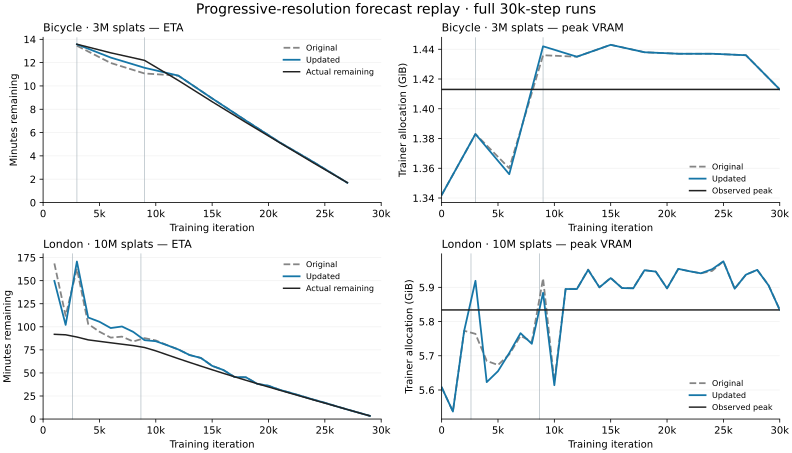

# Training ETA and VRAM forecast

`app/TrainForecast.{h,cpp}` predicts, while a run trains, how long it has left
and how much device memory it will peak at. `TrainerSession::train()` feeds it
one sample per step; the CLI's progress line, `/progress`, the GUI's status
strip and the VRAM bar's hover card read it. `train_forecast_test` checks both
against synthetic runs whose answers are known, and `SS_FORECAST_LOG=1` prints
its state every 100 steps for checking it against a real run.

Both models lean on the same fact: until the model reaches `cap_max`, the
splat count still to come is **known**. So is the image size, under
progressive resolution: `ForecastSetup::resolution_stages`. `engine_densify_step` grows it by
`densify_grows_at` / `densify_target` (`engine/EngineConfig.h`), and
`SplatSchedule` replays that same rule forward. The SH degree schedule
(`min(step / sh_degree_warmup_every, sh_degree)`) is known the same way. So
nothing extrapolates the count or the degree -- only what they cost.

## ETA

Two models of what a step costs, both updated once per window of
`refine_every` steps -- so every window holds the same share of densify
steps -- from the window's wall time per step. Samples past 3x the median
are dropped only when they occupy at most 5% of the window (at least one
sample): pipeline builds are rare, but repeated disk-decoding stalls are real
training time and must remain in the mean. With recurring stalls, the faster
samples fit the compute cost, and the full mean fits a host-throughput floor.
Future segments cost the larger of that floor and their projected compute
cost: GPU work can overlap image preparation. The floor carries 20% relative
uncertainty and decays when windows stop showing recurring stalls. Image
loading is classified per image, not per rendered pixel, because the source
file can stay the same across progressive stages.

GPU timings retain the batch's actual resolution, including sparse densify
samples. A fallback never borrows GPU cells from a different resolution.
Each fit closes after the window's final step breakdown has arrived; the
displayed breakdown uses the current resolution's rows from the recent window.

### With the step breakdown: one term per column

Where the backend times every kernel (Vulkan; docs/notes/step-timing.md) the
breakdown already says how much of a step follows the splats, how much the
splats and the pixels together, and how much neither:

    a + (b0 + b1 * k) * N + exp(s0 + s1 * ln N + q * ln r)

`N` in millions of splats, `k` the SH coefficients the step trains (0, 3, 8,
15). Each term is filtered on its own measurement: `[b0, b1]` on the splats
column, which is linear in `N`; `[s0, s1, q]` on the log of the splat x pixel
column; `a` on what the wall time has beyond the two. `r` is the pixel ratio
relative to the loaded image size. The pixel exponent `q` starts at 0.45 +- 0.2
and is learned when resolution changes; keeping it fixed confounds a change
in pixel work with a change in the splat exponent. Mixed-resolution timing
windows are omitted from this fit. `s1` -- how splat x
pixel work grows with the count -- starts at 0.45 +- 0.15 and is learned as
the count moves (garden ended at 0.40 with floater suppression strong, 0.42
without). Nothing here is a guess at how a lump splits, which is what the
model below has to make before the count has moved.

### Without it: a power law

A step costs `a + (b0 + b1 * k) * N^gamma`, `a` everything that does not
scale with the model (loss, bilateral grids, PPISP, data loading, host
overhead). A Kalman filter updates `[a, b0, b1, c]` from the wall time and:

- the GPU time of the splat stages, `c + (b0 + b1 * k) * N^gamma`.
  `SplatStageTimer` (`engine/EngineStepTiming.cpp`) brackets the forward, the
  raster / projection backward, the optimizer and densify with timestamp
  events on one step in ten; on Vulkan every bracket is a queue submission.

Those stages are NOT all per-splat: rasterization has a large per-pixel part,
~45% of their time on bonsai at 1/4 resolution and nearly all of it at 1/2.
Treating their time as `b * N` overshot the ETA there by +130%. Hence the
intercept `c`: the GPU measurement pins the slope once the count moves (it
has less host noise than the wall clock), and says nothing about it before.
While the count holds still the slope is a prior -- half the splat stages'
time, +-70% -- and the ETA's sigma says so.

No single `gamma` fits: whole-run fits gave 1.0 on bonsai at 1/4 resolution,
0.85 at 1/2 and 0.8 on garden. So three filters run, at 0.75, 0.875 and 1.0,
each scored on how well it predicted each window before seeing it
(discounted by 0.9 a window), and the ETA is the weighted mixture. Updates
are gated at 2 sigma with a 10% floor: the laptop GPU these were measured on
ran whole 100-step windows 40-60% slow, four times in one run.

The lump cannot follow a mix of a linear and a square-root-like term: garden
with floater suppression strong goes from 0.5 + 2.4 ms of the two columns at
139k splats to 3.4 + 4.6 at 1M, an effective exponent of 0.53, under the
smallest `gamma` here. Its ETA there was 53% of the run over at step 1000,
where the column model is 21-25% over.

### What both add

The checkpoint saves still to come, at the seconds per million splats the
saves so far took; a save is excluded from its step's wall time for that
reason.

On a 6,000-step bicycle replay (3M cap, SH3, loaded at half size, progressive
switches at steps 1,014 and 2,535), mean absolute ETA error over the five
1,000-step checkpoints fell from 9.4% to 6.8% of whole-run time. At step 2,000
the error fell from -23.8% to -8.7%; the run took 175.7 seconds. Before the
change, the timing filter discarded 34–41% of the steps around that point as
outliers. GPU growth hides some of those producer stalls, so simply adding
them as fixed overhead overshoots instead. These are replay results on one
trace, not an assertion that every scene improves by the same amount.

A full 30,000-step bicycle run with the same 3M cap, half-size inputs and
automatic progressive stages took 833.4 seconds with the disk cache enabled.
Replaying its nine 3,000-step checkpoints reduced mean absolute ETA error
from 2.5% to 1.6% of run time. At step 9,000 the underestimate fell from 8.1%
to 4.6%. Projected VRAM peaks were within -5.0% to +2.1% for both versions.

The full-resolution London run (3504 x 2336, 30,000 steps, 10M SH3 splats,
automatic stages at 2,604 and 8,680, disk cache initially cold) took 5,629.9
seconds of training. Across its 29 checkpoints, mean absolute ETA error
**increased from 10.71% to 11.64%** of run time. During the warmed half-size
stage (steps 4,000–8,000), it increased from 9.79% to 20.35%; at full size
(9,000 onward), it fell slightly from 3.75% to 3.59%. The fitted pixel
exponent was 0.674 during the half-size stage, against the old fixed 0.45.
The host-throughput floor contributed zero there: this regression is in
extrapolating GPU work across resolutions, not retained image-loading stalls.
Peak trainer allocation was 5.834 GiB; projected peaks were within -5.1% to
+2.4% for both forecasters. Held-out raw PSNR/SSIM were
24.6626/0.76769 over 248 views; aligned values were 25.2057/0.78635.

Both forecasters replay the identical complete trace for each dataset. Runs
used Vulkan on an RTX 5070, default 3DGS settings, `max_resolution=0`, and
`cache_downscaled_images=true`; only the stated iteration count, splat cap
and loaded divisor differ. Their default sampling seed was time-based, so
these are paired forecast replays, not controlled training-quality comparisons.
Thin vertical lines mark the actual resolution changes. Memory is the trainer's
tracked peak allocation, not whole-device use reported by the driver. The
London process wrote its final model, all 30,000 trace samples and all eval
metrics; its execution wrapper reported exit 143 after evaluation, with no
OOM recorded. The scope peaked at 17.5 GiB of host memory including file
cache. The shutdown signal's origin was not established.

Few resolution stages cannot cleanly separate pixel scaling from changing
splat counts and evolving footprints. Cold PNG creation is also a transient
workload that the remaining-time model does not forecast separately. The
reported sigma describes model uncertainty, not a statistically calibrated
confidence interval; these workload changes can exceed it.

A regularizer that starts mid-run (`ForecastSetup::reg_start_step`, the PCA
regularizer's `--pca-reg-start-iter`): its seconds per million splats are
measured apart (`add_regularizer`, the median of the last nine), taken out of
the wall time and the splats column of the steps that run it, and charged to
every step from the start step on. Before the start step the engine times a
probe pass every 50 steps (docs/notes/pca-reg.md), on either backend, so the
ETA carries the regularizer from step 60 and does not move when it starts: on
garden it used to rise by 14% of the run over the 500 steps around step 4500.
A probe at 139k splats reads the cost per splat about 25% high, 0 by 450k.

### The image size

Under progressive resolution a step at a quarter of the size costs a fraction
of a full one, and a model fitted on the early stages alone forecast the run
at that rate. So both terms carry the pixel ratio `r` (the step's pixel count
over the full size's):

    a (f_a r + 1 - f_a) + (b0 + b1 k) N^gamma (f_b r^0.45 + 1 - f_b)

`f_a` is the share of the time outside the splat term that follows the
pixels, `f_b` the share of the splat term in the splat x pixel kernels; both
come from the step breakdown (docs/notes/step-timing.md), converted from the
`r` they were measured at to full size, with priors 0.75 and 0.5 before it
has measured. The power-law fallback uses `r^0.45`, the splat x pixel kernels' measured
pixel exponent; the column model learns its own exponent across stages.
Without progressive resolution `r = 1` and the model is the one above.
Measured steps carry their actual batch divisor, including the early and late
batches delivered by disk prefetch near a stage boundary. Before the first
fitted window, the provisional wall-time estimate integrates the same stages
using equal fixed/splat shares rather than extending the coarse rate. On a
synthetic run of 1/4, 1/2 then full size the ETA at step 1000 (1/4 size) was
6% over the truth where the last 100 steps' rate said half of it.

Replayed on recorded runs (`train_forecast_replay`, Vulkan, RTX 5070, 1M
cap, 30k steps unless said), error in the time left as a share of the whole
run, every 500 steps to step 5000 -- the count reaches the cap by 4600:

| run | power law, mean abs | columns, mean abs | columns at 500 / 1000 / 2000 / 3000 / 5000 |
|---|---|---|---|
| garden 1/4 | 15% | 5% | +8 / +8 / +7 / +4 / +3 |
| garden 1/4, floater suppression strong | 27% | 13% | +21 / +25 / +16 / +12 / +4 |
| bonsai 1/2 | 7% | 4% | -7 / -2 / +5 / +4 / +2 |
| bonsai 1/2, strong | | 11% | +2 / +9 / +18 / +14 / +7 |
| 360 preset, 5650 views, 10k steps | 3.5% | 2% | -8 / -6 / -1 / 0 / +1 |
| 360 preset, strong | | 3.5% | -5 / -1 / +5 / +4 / +2 |

What is left is what no step so far can say. `s1`, before the count has
moved: 0.5 +- 0.2 against garden's 0.40, bonsai's 0.62 and the 360 preset's
0.92 over its short early growth. And, with floater suppression strong, the
splat x pixel column falling by a quarter between the cap and the end of the
run as splats shrink (4.7 to 3.5 ms on garden; 6% without it), which the
filter follows but does not anticipate. A step's last-100-steps rate, the
naive estimate, read 23% to 66% low on these runs while the count still grew.

## VRAM

Only `splat x pixel` grows during training (docs/notes/vram-splat-x-pixel.md),
so ours at a future step is everything else now plus that category,
projected. It is projected from what its buffers hold, not from its total:

- **Visible pairs** (`nnz`, the most one forward has made): the screen rows,
  boxes and ids outside the arena, and the raster backward's phase inside it.
  They follow the splat count -- the view that sees most of the model keeps
  its share of it -- so they are scaled by the count, +-10% per e-fold.
- **Splat-tile pairs** (`n_isects`, likewise the most): 4 bytes each in the
  list the raster reads, 20 more in the tile phase while a band is sorted.
  These do NOT follow the count: a model of few large splats already makes
  most of the pairs its refined self will (london: 1.5M splats, 8 MP), and
  the count per splat falls as splats shrink. This is the one thing fitted.
- **The arena** is as large as its largest phase, and
  `DevicePool::arena_phases()` says what each asked for, split three ways:
  per-pixel slices (the loss pyramid, sized by the image alone), per-pair
  ones, and per-splat ones -- which the pool carves for `cap_max` from their
  first use, so they are a constant here. The tile phase is recomputed with
  the intersector's own rule (`intersect_bands_for`) at the projected pairs;
  the densify lists are 28 bytes a splat of `cap_max` before a relocate has
  carved them.

One thing can still raise the pairs without the count or the views moving:
the engine's search for the binning tile size trying, or adopting, a finer
bin (docs/notes/binning-tile-size.md) -- bonsai went from 2.5M to 4.9M pairs
at step 5200, 1100 steps after its cap, 3.8 sigma above what the forecast
held. `engine_bin_finer_isects` says what the peak would be at the finest
size the search may still try -- two sizes down while neither is ruled out,
since a size that is adopted has the next tried at once -- or 0; the
projection carries a quarter of the difference, +- half. A rejected trial's
memory is handed back, so what this covers is mostly a transient of a dozen
steps, and one the search only takes when it fits a tenth of the free device
memory.

Nothing else is added at a later step: what a schedule turns on mid-run (the
PCA regularizer, the calibration warp) reserves its memory from step 0
(docs/notes/vram-splat-x-pixel.md), so the forecast has no start steps to know.

`engine_get_isect_peaks` supplies the two pair counts and the last forward's
splat-tile pairs. Without them (`SS_POOL_ALIAS=0`, which leaves the arena
out) the fit is of everything that follows the splats at once, as it was.

Three things the forecast got wrong before it was built this way, each seen
on london (fisheye, 3504x2336, `--cap-max 15000000`, 1.5M splats at start):

- the arena's loss phase -- 0.28 GiB at 8 MP, of the 0.41 GiB the category
  held at first -- was extrapolated per splat with the rest: 14.5 GiB
  projected at the start against the 10.2 the run reached;
- the spread of a step's demand was measured over all views and applied as a
  normal tail. Indoors most views see a sliver of the model and a few see all
  of it: the spread is the lower tail's, and the largest views were in the
  window already. A run at its cap for 19000 steps still projected +1.5 GiB;
- the peak was a running max over the schedule's segments, each adding its
  own share of an error that is common to all of them (13.8 GiB against 10.5
  without it, at step 500).

The splat-tile pairs are `g0 + g1 * N^p * r^0.35`, a Kalman filter over
`[g0, g1]` per exponent `p` (0.6, 0.8, 1.0) from one high-water measurement
per window, starting at `g0 = 0`, the exponents weighted like the ETA's by how
well each predicted the next window, from a prior of 0.2 / 0.3 / 0.5 that
leans linear: under-reading a peak is the costly mistake. `r^0.35` is the
category's measured exponent in the pixel ratio (docs/notes/step-timing.md);
under progressive resolution the Image category and the arena's per-pixel
slices are projected in proportion to `r`. The projection splits at resolution
boundaries even while the splat count is held constant. Pool high-water sizes
are normalized by the finest batch resolution seen, so a late coarse batch
from disk prefetch does not make retained finer buffers look larger per pixel. The peak is the larger of the
high-water measured so far and the demand at the count that asks most, taken
once. What widens it:

- the views not seen yet. The pool keeps the largest draw, so a count held
  for longer than a window sees larger ones: the expected largest of the
  draws to come less that of the draws seen, times the sigma of the TOP of a
  step's log demand (a window's top twentieth; 0.25 before one has closed).
  A count already held has seen its draws, and after one round of the views
  all of them -- a run at its cap projects what it has measured;
- 0.3 relative sigma per e-fold the count is extrapolated (the fit), 0.1 for
  the visible pairs;
- 0.15 relative sigma per e-fold of steps still to run, whatever the count:
  splats shrink and spread as a run goes, so the tiles each covers move even
  once the count is at the cap;
- how far a window's own peak rose ABOVE the fit, while views remain unseen.

The growth is read off the process **high-water**, not the pool, and not off
a sample at the end of the step: the backend counts the peak of what the
process holds (`MemoryUsage::process_peak_bytes`), and the trainer restarts it
after each sample, so a transient inside the step is carried as a constant on
top. The first densify step allocates scratch of its own, so the fit starts
after it; before that the forecast is provisional -- growth all per splat,
+-70% -- and the band says so by its width.

`SS_FORECAST_DUMP=<file>` records everything both models are fed
(`app/ForecastTrace.h`) and `train_forecast_replay <file> [every]` runs them
over it again: projected peak, sigma and error against the peak the run
reached, then the ETA against the wall time the rest of the run took. That is
how a change here is checked against real runs without training them.

Replayed on three recorded runs (Vulkan, RTX 5070), error in the projected
peak against the peak the run reached, before this model and with it:

| run | at step 1 | first 1000 steps | growth | at the cap |
|---|---|---|---|---|
| london, 15M cap, to 8100: before | +67% | +25% to +70% | +1% to +9% | +5% to +8% |
| london: now | -5% | 0% to +14% | -5% to +7% | 0% to +2% |
| garden 1/4, 1M cap, 30k: before | +86% | +26% | +1% to +9% | +1% to +2% |
| garden: now | -5% | 0% | 0% to +13% | 0% to +1% |
| 360 preset, 5650 faces, 10k: before | +24% | +3% | | -1% to +2% |
| 360 preset: now | -9% | -4% | | -2% to +1% |

Now the truth is inside 2.4 sigma at every checkpoint of the three (250 steps
apart on london, 1000 on the others). The under-reads are the first steps,
when one view has been drawn and the band is at its widest (london 8.1 +- 0.8
GiB against 8.5).

"Others" is device use minus ours (on CUDA that includes the context), an
exponential average with its spread. The chance of running out is the normal
tail of `peak + others` above 99% of the device -- the last percent is
fragmentation -- through the same rule every memory forecast uses
(`assess_oom`, docs/notes/memory-forecast.md). Low below 10%, medium below
50%, high above; the trainer logs a warning the first time the risk reaches
each of medium and high.

On Windows there is a second ceiling. WDDM charges every device allocation to
the system commit limit (RAM plus page file): on the RTX 3070 laptop a 4140
MiB pool raised the commit charge by 4140 MiB and the process's private bytes
matched its VRAM. With a small page file the commit runs out first and the
allocation fails as an out-of-memory with VRAM to spare -- the 13M-splat run
in vram-splat-x-pixel.md left 0.2 GiB of commit and an 8 GB device. So on Vulkan
under Windows the limit is the lower of the device's and ours plus the commit
still free (`limit`, `commit_limited`), and the out-of-memory error
says so when commit is what is short.

